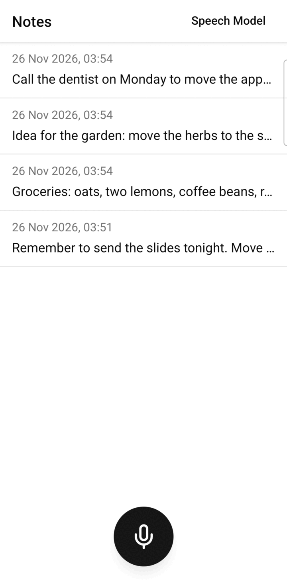
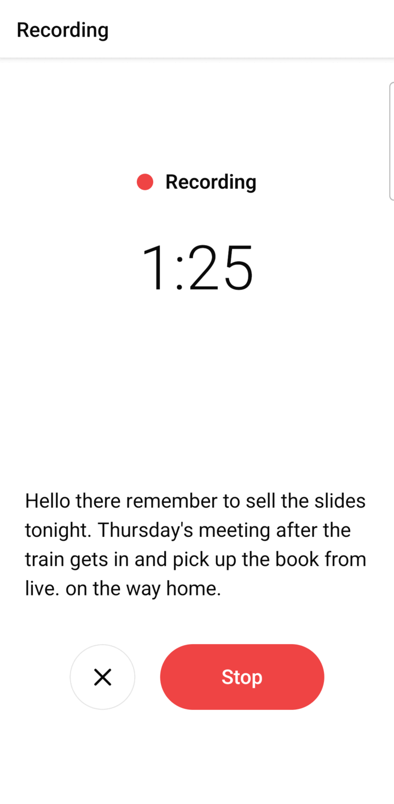
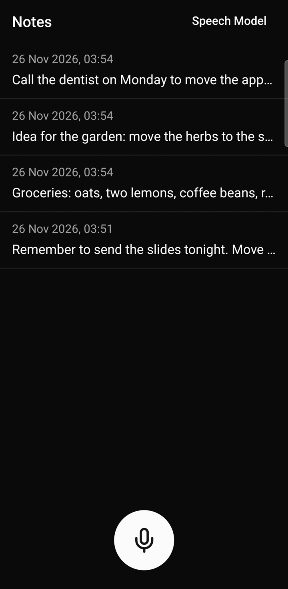
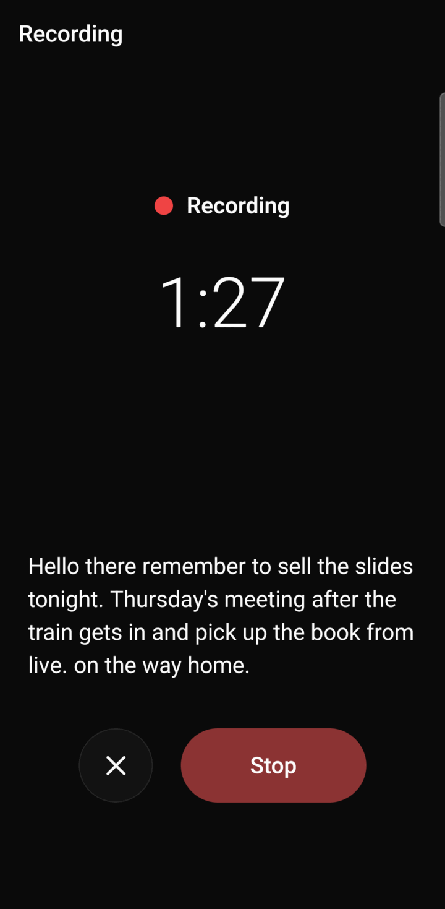

# voi-note

voi-note is an Android app that turns speech into text notes, transcribed entirely on the phone. Tap the icon and it is already recording. Talk, tap **Stop**, and the Note opens with its text ready. Nothing leaves the phone: there is no account and no server, and after a one-time model download it works offline.

|                                       Notes                                       |                                            Recording                                             |                                     Note                                     |
| :-------------------------------------------------------------------------------: | :----------------------------------------------------------------------------------------------: | :--------------------------------------------------------------------------: |
|  |  |  |
|    |    |    |

## Install

1. On the phone, download the APK: <https://github.com/Sheriff-Hoti/voi-note/releases/latest/download/voi-note.apk>. This link always serves the newest release.
2. Open the downloaded file. Android asks you to allow your browser (or file manager) to **install unknown apps**. Allow it, go back and tap **Install**.
3. Open voi-note. On the setup screen, allow the microphone and tap **Download** to fetch the Speech Model: about 663 MB, once. Wi-Fi is recommended; the app warns you when you are on mobile data. The download resumes if it is interrupted, and the files are checked before use.
4. From then on, launching voi-note from its icon starts recording straight away.

**Requirements:** Android 7.0 or later on a 64-bit ARM (arm64) phone, with about 1 GB of free RAM while recording and about 800 MB of free storage for the app and the Speech Model. It has only been tested on a Samsung Galaxy A54.

Updates install over the existing app and keep your Notes. Uninstalling the app deletes the Notes and the Speech Model.

## Privacy

Everything stays on the phone. Recordings are transcribed on the device, and Notes are stored only in the app's own storage. There is no account, no cloud, no analytics and no network access apart from the one-time Speech Model download from Hugging Face. Sharing a Note is something you do, as text, through Android's share sheet.

## How it works

- **Instant Capture.** Launching the app from its icon starts a Recording at once (about 0.6 s on the A54). The Speech Model takes about 6 s to load in the background. Audio is buffered meanwhile, so nothing said during loading is lost.
- **Transcribed while you talk.** The app cuts the Recording into chunks at your pauses and transcribes each chunk as you go, so the text appears a few seconds behind you. Silence is skipped, and a stretch with no pause is cut after 12 s at its quietest point.
- **Ready at Stop.** When you tap **Stop**, only the last chunk is left to transcribe, so the Note opens with its text almost at once (about 0.2 s on the A54).
- **Discard.** **X** throws a Recording away, with a short Undo. A Recording stops by itself at 5 minutes and is saved like a normal Stop.
- **Memory.** The Speech Model uses about 1 GB of RAM. It is released as soon as the app goes to the background, and loaded again when you come back.

Notes can be listed, read, edited, deleted and shared as text.

## Stack

- [Expo](https://expo.dev) React Native and TypeScript, with [React Native Reusables](https://reactnativereusables.com) for the UI.
- [react-native-sherpa-onnx](https://github.com/XDcobra/react-native-sherpa-onnx) 0.4.4 runs the Speech Model. A postinstall script swaps in sherpa-onnx 2.0.3 and ONNX Runtime 1.28.2, which this model needs, and every build checks that the swap held ([ADR 0002](docs/adr/0002-react-native-sherpa-onnx-with-native-swap.md)).
- Speech Model: NVIDIA [Parakeet Unified EN 0.6B](https://huggingface.co/nvidia/parakeet-unified-en-0.6b), English only, as sherpa-onnx's offline int8 export, pinned to one revision ([ADR 0001](docs/adr/0001-english-only-parakeet-unified-en.md)).
- Notes are stored in SQLite (expo-sqlite).

## Develop

The toolchain (Java 17, Node 24, Android SDK) is pinned in `mise.toml`. With [mise](https://mise.jdx.dev) activated in your shell:

```sh
mise install
npm install          # also runs the sherpa-onnx native swap (ADR 0002)
npm run check        # lint, types and tests, as CI runs them
```

Build and run a debug build on a USB-connected phone (or the emulator), with Metro:

```sh
npx expo run:android --device
```

`android/` is generated by `expo prebuild` and not checked in. Debug builds include arm64-v8a and x86_64 (for the emulator). Every `assembleDebug` and `assembleRelease` runs `scripts/check-ort-symbol.sh` and fails if the native swap did not apply. You can also run that check on its own with `npm run check:apk`.

The voice-notes core and the model installer are tested through their public interfaces, with fakes for the microphone, the Speech Model, storage and the network. The speech engine, the microphone and the screens are checked by hand on the phone: `.claude/skills/device-check/SKILL.md` lists the steps.

## Release

[`.github/workflows/release.yml`](.github/workflows/release.yml) builds an arm64-v8a release APK signed with the voi-note release key ([ADR 0005](docs/adr/0005-own-release-signing-key.md)). It checks the native swap, the ABI and the signing certificate.

- A tag `vX.Y.Z` builds the APK and attaches it as `voi-note.apk` to a GitHub Release. The version comes from the tag: versionName `X.Y.Z`, versionCode `X*10000 + Y*100 + Z`.
- A push to `main` or a manual run uploads the APK as an Actions artifact, kept 14 days.

To release, tag a commit on `main` and push the tag:

```sh
git tag v0.2.0
git push origin v0.2.0
```

Signing needs four repository secrets: `RELEASE_KEYSTORE_BASE64` (the PKCS12 keystore, base64), `RELEASE_KEYSTORE_PASSWORD`, `RELEASE_KEY_ALIAS` and `RELEASE_KEY_PASSWORD`. The keystore itself is kept outside the repo. Android installs an update only if it is signed with the same key, so losing the key means users must uninstall (and lose their Notes) to get a newer version.

## Docs

- [`GLOSSARY.md`](GLOSSARY.md): the terms used in the code and the app (Note, Recording, Transcript, Speech Model, Instant Capture, Discard).
- [`docs/adr/`](docs/adr/): the decisions behind the design.
- [`docs/prototypes/`](docs/prototypes/): measurements on the Galaxy A54 that the design rests on.

## License

voi-note is released under the [MIT License](LICENSE).

Third-party components:

- **Parakeet Unified EN 0.6B** by NVIDIA, under the [NVIDIA Open Model License](https://www.nvidia.com/en-us/agreements/enterprise-software/nvidia-open-model-license/). The app downloads it from Hugging Face ([sherpa-onnx's int8 export](https://huggingface.co/csukuangfj2/sherpa-onnx-nemo-parakeet-unified-en-0.6b-int8-non-streaming)) at setup. It is not included in this repository or the APK.
- **[sherpa-onnx](https://github.com/k2-fsa/sherpa-onnx)** by k2-fsa, Apache-2.0, bundled in the APK together with its ONNX Runtime build (MIT).
- **[react-native-sherpa-onnx](https://github.com/XDcobra/react-native-sherpa-onnx)**, MIT.
